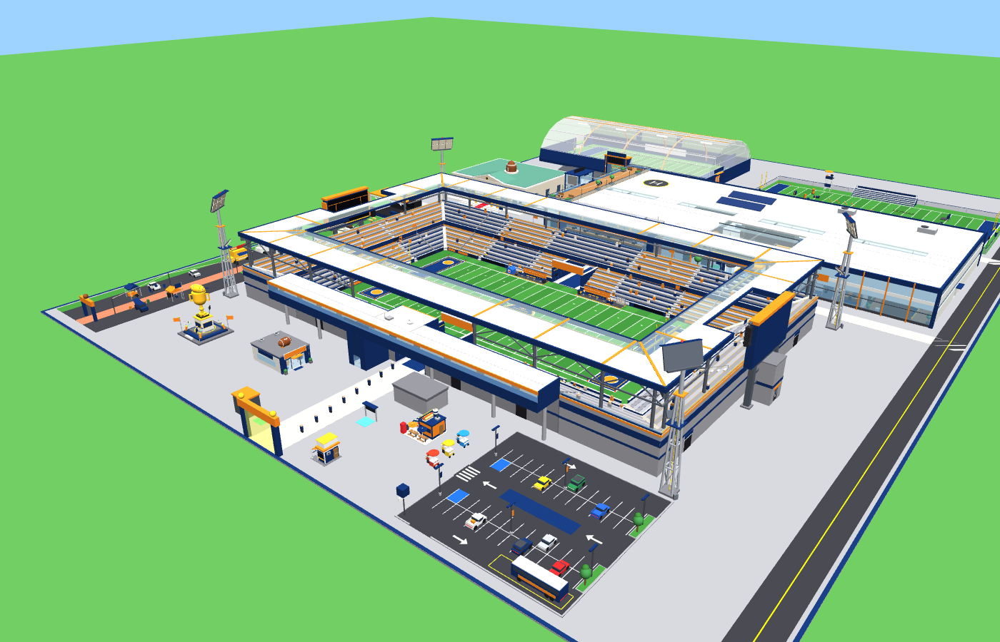
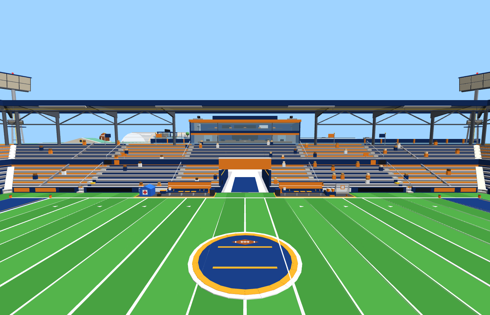
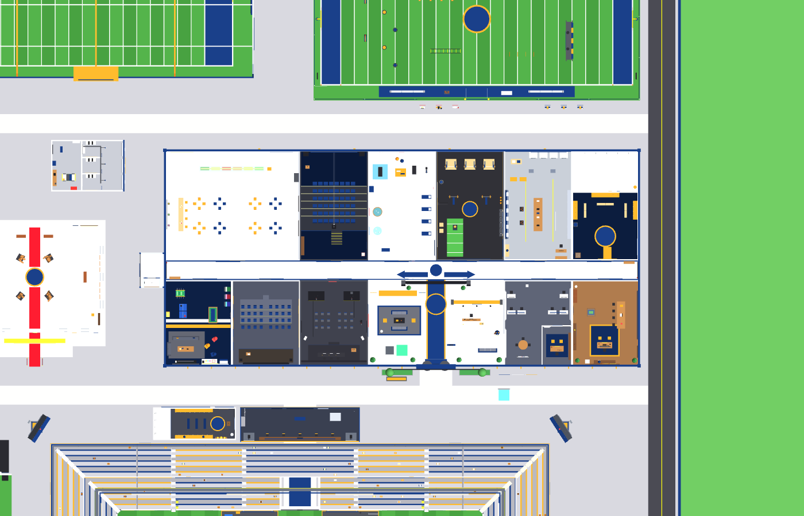
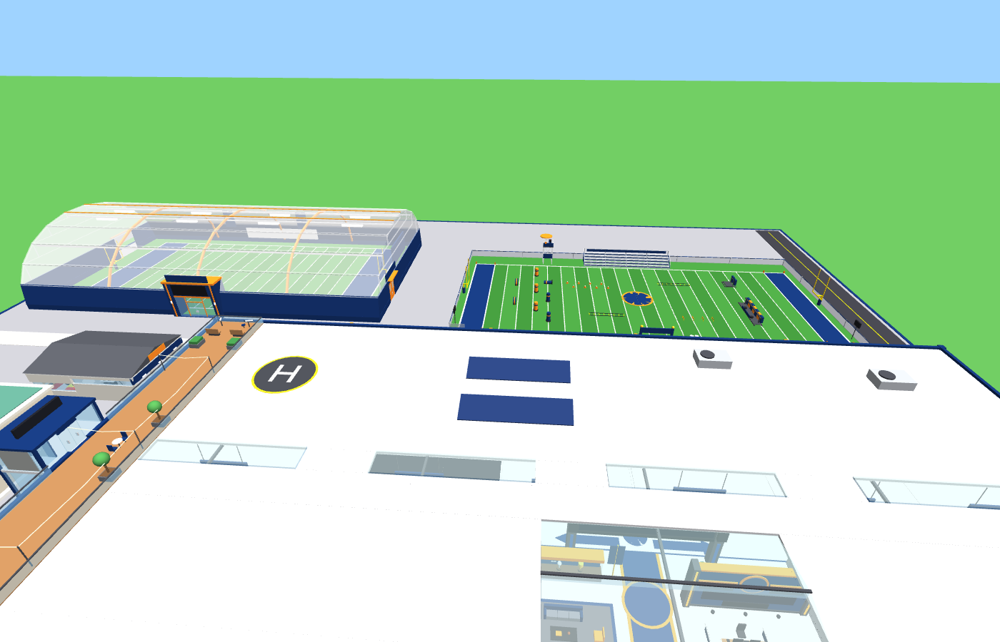
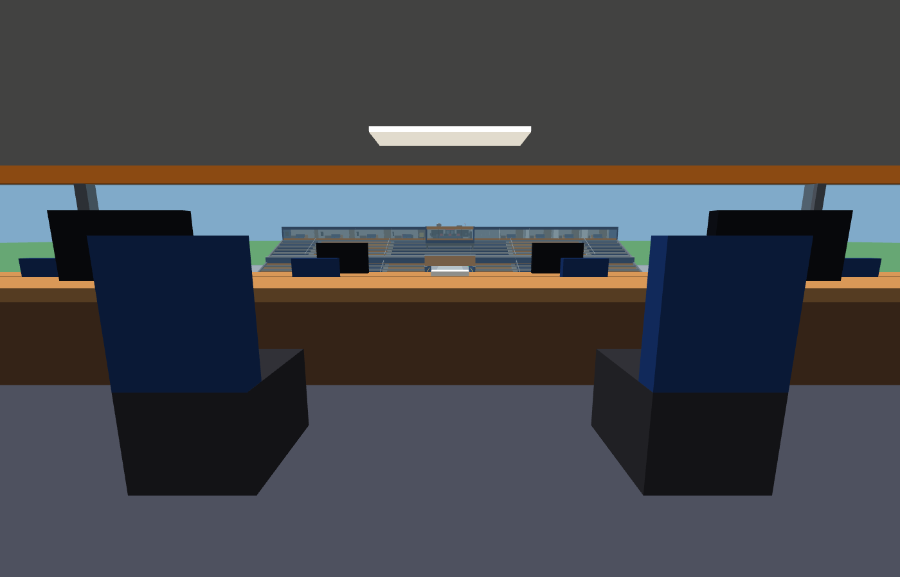
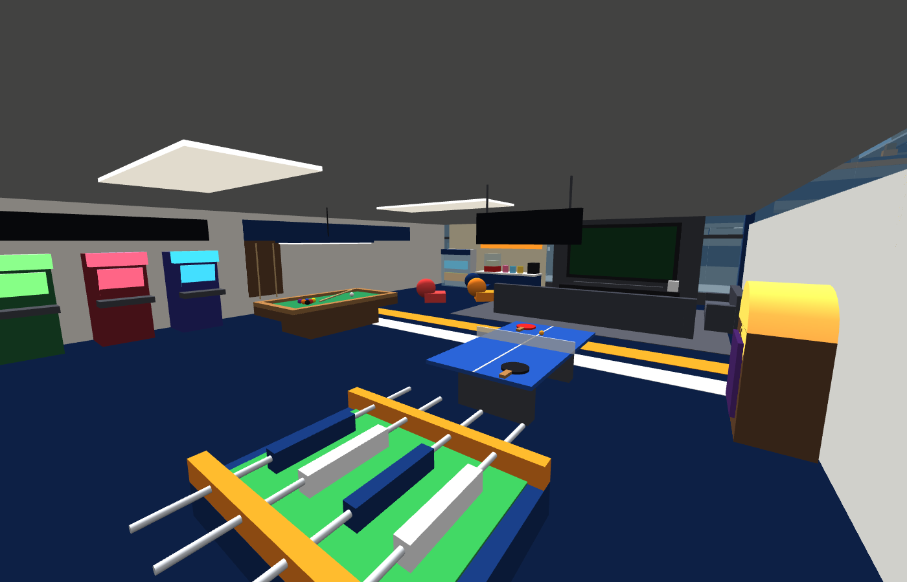
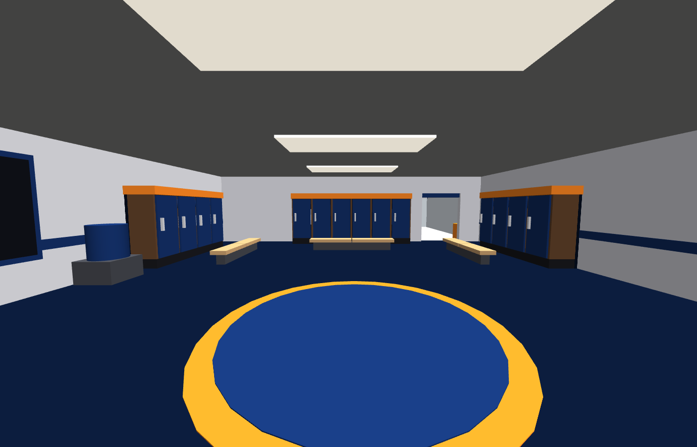

# Gridiron Stadium Tycoon (Roblox)

A Roblox tycoon where every player builds a pro-football franchise from nothing. You start
inside an **empty team headquarters** and fill it room by room: lobby, front office, locker
room, coaches' offices, weight room, equipment room, training room, film room, team meeting
room, cafeteria, player lounge and interview room. Then you build the **practice campus**
behind it (practice field, practice gear, indoor dome, golf cart garage, Hall of Fame) and the
**stadium** in front of it. The stadium grows from bare turf into a **full bowl** with two
decks, locker rooms, a press box, a TV booth, suites, a jumbotron and a ring canopy. A
**tailgate fan zone** sits beside it. The last piece is a giant championship trophy.

Nothing appears in one click. Every piece is built in **2 to 6 steps**. For example, the
practice field goes grass, then yard lines, then end zones, then goal posts, then fence and
sideline, then bleachers. That makes **177 build steps** in 49 pieces.

Everything is **walk-in and interactive**. Rooms have doors that open, chairs and couches you
can sit on, and "Press E to look" prompts (tap on a phone) on interesting things. You can lift
weights, grab a smoothie, play arcade and ping-pong, hold press conferences and ride elevators up
to the press box and suites. Press-box and broadcast-booth seats switch to a TV camera, and
screens everywhere show your live score, record and season.

On top of building, you **run the team**. You pick your colours and nickname, draft and
train players, hire coaches, kick field goals, play game days and seasons, and chase quests
and championships.



| Game day from the 50-yard line | Inside the team HQ | Practice campus |
| --- | --- | --- |
|  |  |  |

| Inside the press box | Player lounge (arcade, ping-pong, pool) | HQ locker room |
| --- | --- | --- |
|  |  |  |

*Previews are rendered offline from the real build code (tools/), so signs, screens and text aren't shown.*

## Versions

| Version | What's in it |
| --- | --- |
| 1 | Core stadium: 23 pieces, plots claimed at a gold gate, vault + collect pad, saving, day/night, HUD |
| 1.1 | Polish: pulsing buy buttons, a guide beam to your next button, sounds, "Unlocked: ..." messages, vault hints, full-server handling |
| 2 | Front office + practice campus behind the stadium, a Team Bus, a second collect pad. The stadium becomes a full bowl with a home tunnel, two locker rooms, a bigger press box and a TV booth |
| 3 | Game days: NPC fans walk in and fill the stands, double income, a countdown in the HUD |
| 4.1 | Walk-in, interactive rooms: doors, elevators to the press box / suites / HQ roof, seats with TV camera views, "Press E to look" descriptions (lockers show your players' names), lift weights, arcade, ping-pong, press conferences, snacks and drinks to carry, live screens with your score, record and season |
| 4 | Much bigger plots. You start inside an empty **Team HQ** with 12 rooms to build. Every piece is built in 2-6 steps (177 steps). New: drivable **golf carts**, a **Hall of Fame & Museum**, a **tailgate fan zone**, cafeteria, player lounge, interview room, coaches' offices, equipment room and meeting room. Team features: **team picker, Owner's Bonus, quests, draft + roster, training, hired staff, field goal challenge, seasons + playoffs + titles**, and a leaderboard |

## Play it in Roblox Studio

1. Download [`build/StadiumTycoon.rbxlx`](build/StadiumTycoon.rbxlx).
2. Double-click it (or in Studio: **File > Open from File...**).
3. Press **Play** (F5).
4. Walk through a glowing **gold gate** to claim a franchise. You are taken into your empty
   **Team HQ** and asked to **pick your team colours and nickname**.
5. Step on the glowing **buttons** to build. Green = you can afford it, red = not yet. Each
   button says which step it is ("Step 2/5: Lockers"). A golden **guide beam** points from
   you to your next button.
6. Your franchise earns money every second. It piles up in the **vault**. Step on a **collect
   pad** to move it into your cash (standing on it keeps collecting). There is one in the
   HQ lobby (the Team Safe) and one by the stadium gate.
7. Get around on foot, on the **Team Bus** (blue pads: HQ <-> stadium plaza), or in a
   **golf cart** once you build the garage. Sit in the driver's seat and drive with
   W/A/S/D (or the thumbstick on a phone).

The plots, buttons and buildings are built by the scripts when the game starts, so in edit mode
you only see the ground and the spawn point. That's expected: press Play.

**Multiplayer test:** in Studio open the **Test** tab, set *Clients and Servers* to 2 players
and press **Start**. Each player can claim a different franchise (4 plots per server).

**Build faster while testing:** open `ReplicatedStorage > TycoonShared > Config` and set
`Config.IncomeMultiplier = 50`. To see a game day sooner, set `Config.GameDay.IntervalSeconds = 30`.
Put both back before publishing.

### Before you publish: set the server size

Each server has 4 franchise plots (`Config.PlotCount`, the plots are very big now). In
**Home > Game Settings > Places**, set **Max Players** to **4** so every player gets one. If a
server is ever full, players without a plot are told that all stadiums are taken and get a
message when one opens up.

### Turning on saving

Progress (cash, everything you built, your team, roster, quests and record) saves with a
DataStore. That only works when:

1. The place is published: **File > Publish to Roblox**.
2. In Studio: **Home > Game Settings > Security > Enable Studio Access to API Services** is ON.

Without that the game still works. The bottom-left of the screen shows
"Progress saving: OFF" and nothing is saved. Saving happens automatically every 90 seconds,
when a player leaves, and when the server shuts down.

How saving stays safe:
* A session lock stops two servers, or a quick leave-and-rejoin, from overwriting each other.
* Temporary Roblox outages are retried.
* If a save can't load, the player is told it is safe and nothing overwrites it.
* Pieces from a newer version of the game are kept, not deleted.

## How the game works

### Building

| Thing | What it does |
| --- | --- |
| Gold gate | Touch it to claim an empty franchise (one per player). |
| Buy buttons | One per piece. It shows the piece, the step ("Step 3/6: End Zones") and the price. After you buy a step, the next step's button appears in the same spot. |
| Guide beam | A golden beam from your character to the cheapest button you can see. |
| Vault + collect pads | Income piles up in the vault. Step on a collect pad (HQ lobby or stadium gate) to collect. |
| Team Bus | Blue pads at the HQ and in the stadium plaza teleport you between them. |
| Golf carts | The garage gives you up to 3 carts in your team colours. Abandoned carts drive themselves home. |
| Day / night | A full day takes 10 minutes. Stadium lights switch on at night. |

### Things to do around your franchise

| Thing | How it works |
| --- | --- |
| Press E to look | Prompts on interesting objects (tap them on a phone) show a short description. Some show live info from your team: lockers show your players' names, trophy cases show your championships, the Draft Board shows the next pick's price. |
| Doors | Every room has a door: press E to open it. Doors close again by themselves. |
| Elevators | Ride up to the press box, the luxury suites, the upper decks, the scoreboard catwalk, the practice-field coach tower and the HQ rooftop deck (and back down). |
| Seats | Sit on chairs, couches and benches. Press-box, broadcast-booth and other camera seats switch to a TV view of the field with a LIVE badge and your score. Jump to stand up. |
| Weight room | "Lift weights": tap fast to push the bar. Counts workouts and pays a little. |
| Lounge | Arcade "Pigskin Catch" (catch falling footballs) and ping-pong rallies. High scores show on the machines. |
| Interview room | Take the podium and answer a reporter. Each press conference adds team hype: +1 rating in your next game day (up to +3). |
| Snacks | Grab a lunch tray or a smoothie in the cafeteria, hot dogs / popcorn / sodas from the vendors and food trucks, a foam finger at the team store. Click to eat or drink; smoothies and sports drinks make you faster for a bit. |
| Live screens | Screens and boards everywhere show your team name, the score, your record, the season, your starters and the game-day countdown. |

### Running the team

| Feature | How it works |
| --- | --- |
| Pick your team | Choose one of 6 colour schemes and a nickname (Comets, Thunderhawks, Ironclads...). Everything you built is repainted, including the carts. Change it any time with the **TEAM** button. |
| Owner's Bonus | A free cash gift every 8 minutes: the gold **BONUS** button on the right shows the countdown. |
| Quests | 30 goals with cash rewards, shown on the left ("Finish 2 HQ rooms", "Kick a 55-yard field goal", "Win a championship"...). |
| Draft | Build the **Draft Board** in the Front Office, then draft players from the **ROSTER** screen. Each has a position (QB, RB, WR, OL, DEF, K) and a rating. Your film room, coaches' offices and coaching staff give better picks. |
| Training | Finish the **Weight Room** to train your weakest starter (+1 to +3 rating, +1 more with a Training Room). |
| Staff | Hire a coaching staff and a medical staff (they appear on the practice field and raise your team rating) and food vendors for the plaza. |
| Field goals | When the goal posts are finished, three kick spots appear on your field (25, 40 and 55 yards). Step on one, stop the aim needle in the green, then stop the power bar past the gold line. Good kicks pay. |
| Game days | Every 4 minutes fans walk in and fill the stands you built, income is doubled for 60 seconds, and your team plays. Your team rating against the opponent decides the odds. The score goes up on your scoreboard. |
| Seasons | Every game day is one week. Win 5 of 8 to make the playoffs: a semifinal, then the championship game. Titles pay a big prize. |
| Leaderboard | The player list shows Wins, Rating and Titles. |

Team colours: navy & orange, crimson & gold, forest & silver, purple & black, teal & black,
royal & white. All team names are made up, so no real league teams, logos or trademarks are used.

### The build order (49 pieces, 177 steps)

**Team HQ:** Lobby & Reception (first step free) -> Front Office -> Locker Room ->
Coaches' Offices

**Campus:** Practice Field -> Weight Room -> Equipment Room -> Golf Cart Garage ->
Practice Gear -> Training Room -> Film Room -> Team Meeting Room -> Coaching Staff ->
Medical & Training Staff

**Stadium:** Turf -> Yard Lines -> Team Benches -> End Zones -> Cafeteria (HQ) -> Goal Posts ->
Ticket Booth -> Midfield Logo -> Concession Stand -> Food Vendors -> Player Lounge (HQ) ->
Home Stands -> Home Locker Room -> Interview Room (HQ) -> Visitor Stands -> Visitor Locker Room ->
Scoreboard -> Parking Lot -> West + East End Zone Seats -> Corner Seats (the lower bowl closes) ->
Team Store -> Tailgate & Fan Zone -> Stadium Lights -> Home Upper Deck -> Indoor Practice Dome ->
Hall of Fame & Museum -> Visitor Upper Deck -> Jumbotron -> Press Box ->
Upper Bowl Ends (the upper ring closes) -> Luxury Suites -> TV Broadcast Booth ->
Stadium Canopy -> Championship Trophy

Prices, income and steps are in `src/shared/Items.lua`.

## Project layout

```
StadiumTycoon/
  build/StadiumTycoon.rbxlx      the place file to open in Studio (built from src/)
  default.project.json           Rojo project: maps src/ into the place
  src/shared/   -> ReplicatedStorage.TycoonShared
    Config.lua                   all tunable numbers, team colours, seasons, kicks, the plot layout
    Items.lua                    every piece and its steps: price, income, unlock order, button spot
    Format.lua                   money formatting ($12.5K)
    Interact.lua                 the list of interaction kinds, "use" actions, look keys and live screens
  src/server/   -> ServerScriptService.TycoonServer
    Main.server.lua              entry point: builds the world, wires players, saving, loops
    World.lua                    plot positions, street + spawn, day/night cycle
    PlotManager.lua              claiming, buttons, step-by-step purchases, vault, bus, scoreboard
    PlayerData.lua               DataStore loading/saving with session locking
    Franchise.lua                team picker, Owner's Bonus, quests, draft, training, seasons
    Interactions.lua             doors, seats, elevators, snacks, mini-game results (the "Interact" prompts)
    Snacks.lua                   hot dogs, smoothies, trays, foam fingers... (Tools built from parts)
    LiveScreens.lua              keeps every live screen up to date
    KickGame.lua                 the field goal challenge (server side)
    Vehicles.lua                 golf carts
    GameDay.lua                  game day schedule, income boost, crowds
    Crowd.lua                    NPC fan models (seated + walking)
    BuildUtil.lua                helpers for parts, text, lights and build steps
    Builders/                    the geometry, one function per piece (each step marked with BuildUtil.Stage)
      PlotBase.lua               slab, roads, gate, vault, collect pads, team bus stops
      HQShell.lua                the empty Team HQ building (+ elevator to the rooftop terrace)
      HQRoomsFront.lua           lobby, front office, coaches' offices, interview, meeting room, lounge
      HQRoomsBack.lua            locker room, equipment, weight room, training room, film room, cafeteria
      CampusFields.lua           practice field, practice gear, indoor practice dome
      Garage.lua                 golf cart garage
      HallOfFame.lua             Hall of Fame & Museum
      FanZone.lua                tailgate lot, food trucks, games, stage
      Staff.lua                  coaches, trainers and food vendors (NPCs)
      StadiumRooms.lua           home + visitor locker rooms
      Field.lua                  turf, yard lines, end zones, goal posts, midfield, benches
      Stands.lua                 the full bowl: lower + upper decks, end zones, corners
      Plaza.lua                  ticket booth, concessions, parking, team store, trophy
      Features.lua               scoreboard, lights, jumbotron, canopy
      PressLevel.lua             walk-in press box, luxury suites and TV broadcast booth (with elevators)
  src/client/   -> StarterPlayer.StarterPlayerScripts.TycoonClient
    HUD.client.lua               cash / income / progress / game day / save status / pop-ups
    Franchise.client.lua         team picker, bonus button, quests, roster + draft + training
    KickGame.client.lua          the field goal aim + power meter
    Drive.client.lua             golf cart driving
    Interact.client.lua          look cards, TV camera seats, mini-games, elevator fades
    Effects.client.lua           pulsing buttons, guide beam, sounds, cheering fans
  tools/                         offline checks (see below)
  docs/                          preview pictures
```

### Adding a new piece

1. Add a `piece(...)` entry to `src/shared/Items.lua`: id, name, the list of step names, total
   cost, total income, the pieces it requires and its button position.
2. Add a builder function with the same id to one of the `Builders/` modules (and its module
   to `Builders/init.lua`). Start each step's parts with `BuildUtil.Stage(ctx, n)`. Use the
   `BuildUtil` helpers and plot-local coordinates (see the comment at the top of `Config.lua`).
   Make it interactive with `BuildUtil.Look`, `Door`, `Seat`, `Elevator`, `Use` and `LiveText`
   (see the INTERACTIONS section of `BuildUtil.lua` and `src/shared/Interact.lua`).
3. Check it with `lune run tools/render_plot.luau tools/out <piece id>`, then rebuild the place
   file (below) or paste the changed scripts into Studio.

## For developers

These tools are optional. You only need them to edit the code outside Studio.

* **Rojo** (`rojo build default.project.json -o build/StadiumTycoon.rbxlx`) rebuilds the place
  file. You can also use `rojo serve` to live-sync into Studio.
* **Lune** runs the game code outside Roblox:
  * `lune run tools/render_plot.luau tools/out all` builds every step of a complete plot with
    the real builder code and checks it: zones, plot bounds, blocked buttons, clear walkways,
    roads, tunnels and HQ corridors, plus every prompt, door, seat, elevator (it must land on a
    floor with head room) and live screen. Add `crowd` as a third argument to also seat a crowd.
  * `node tools/preview/shoot.js tools/out/parts.json tools/out` renders it to PNG images
    (run `npm install` in `tools/preview` first; needs Playwright + Chromium). `--prompts` marks
    every interaction, `--noroof` hides roofs and `--cam=x,y,z:tx,ty,tz` renders any close-up.
  * `lune run tools/test_server.luau` runs about 370 checks of the server logic and the client
    scripts against a fake Roblox engine. It covers:
    * claiming, step-by-step buying, the vault and auto-collect
    * golf carts and the drive controller
    * the team picker, Owner's Bonus, quests, draft, training, field goals, seasons and playoffs
    * doors, seats, elevators, snacks, mini-game results and live screens
    * look cards, TV camera seats and all four mini-games on the client
    * saving and rejoining, session locks, temporary errors, bad or newer save data, and
      Studio without API access
    * game days and crowds
    * the HUD, team screens, kick meter, guide beam and cheering fans
  * `lune run tools/inspect_place.luau build/StadiumTycoon.rbxlx` checks the built place file.
* **StyLua** (`stylua src tools`) formats the code and **selene** (`selene src`) lints it.

## Ideas for next versions

* Rebirth / "new franchise" for a permanent income boost.
* Upgrades for existing pieces (bigger jumbotron, more seats).
* Gamepasses (2x cash, auto-collect, a faster golf cart).
* Real Humanoid NPC players running drills on the practice field.
